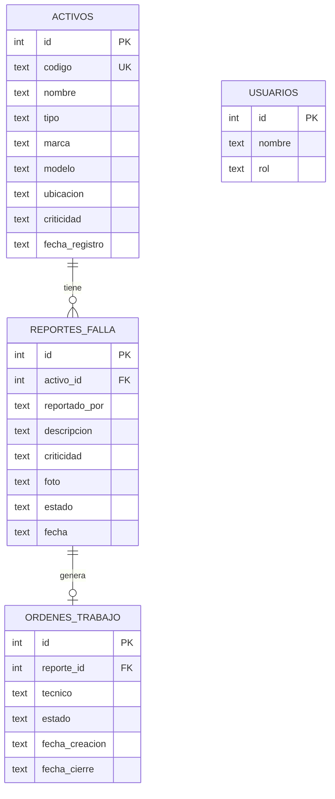

# Diagrama de la base de datos

## Relaciones

- Un **activo** puede tener muchos **reportes de falla** (HU-003a).
- Un **reporte** puede generar una **orden de trabajo** (HU-003b).
- La tabla **usuarios** define los roles (se usará para el control de acceso en el Sprint 2).
